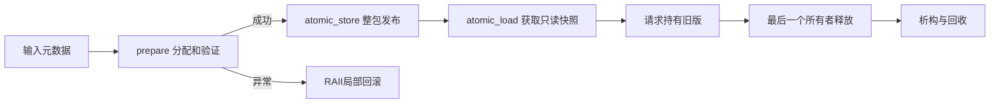

# 2026-10-23 C++ 工程：模型热更新的事务发布与快照寿命

## 工业场景

机器人推理服务更新一个不可变配置包：257个FP32权重、版本号、scale。一个管理线程发布，4个请求线程读取，每个请求必须使用同一版本的所有字段。教学权重代替真实引擎，但所有权协议可用于持有引擎的宿主对象；设备异步完成必须另接事件协议。约束：解析失败不影响旧版本、旧请求不中断、退出不泄漏。今天只测正确性，没有时延SLA或GPU吞吐结论。

## 概念回顾

热更新首先是事务问题：新权重、缩放参数和版本必须一起生效，否则单次请求可能使用旧权重配新参数，数值虽有限却已经违反模型合同。准备阶段在局部对象中完成分配、解析和校验，只有全部成功才进入发布阶段。向量和智能指针负责局部资源，异常沿栈展开时自动回收，旧注册表保持原样。这是强异常保证，它不是捕获异常后继续运行，也不意味着系统永远不会分配失败。

发布之后还要解决对象寿命。请求取得一次共享的只读快照，在整个计算期间持有它；管理线程替换注册表只改变未来读取，已有请求仍引用旧版本。最后一个所有者释放时才析构旧对象，因此更新成功与旧资源回收是两个不同时间点。只读必须覆盖整个对象图，不能通过其他可变别名继续修改权重。普通共享指针的引用计数安全，也不等于同一个指针变量可以被无同步地读写；本例对注册表统一使用原子访问自由函数。

语言保证与库实现也要分开。这里严格采用十七标准可用的接口，不使用后来加入的原子共享指针模板特化。读过的标准库实现用地址散列选择互斥锁，在锁内复制或交换指针，再解锁；原子性不能被解释成无锁或固定延迟。旧对象的析构可能发生在管理线程，也可能发生在最后一个请求线程，重型析构会影响尾延迟。频繁发布且请求长期持有快照还会抬高峰值内存，所以生产系统需要更新限流、读者时限和退休版本观测。当前练习只设一个发布者，多发布者的版本顺序与关闭协议应单独设计，不能从原子替换推导出来。

## 知识图谱



前置：RAII、移动语义、异常栈展开、共享所有权。主机制是强异常保证，耦合机制是原子发布与共享寿命。互斥保护指针替换，不替代对象内部同步；`const`指针也不自动消除外部别名。C++保证接口语义，libc++的锁表是实现细节，OS阻塞和ARM原子指令不能反推统一延迟。

## 编码练习

唯一必做任务，25分钟：先运行已完成例子，再在`prepare`的`fail_stage == 2`附近增加一条输入校验，例如scale必须属于业务允许范围，并为失败补上“当前快照地址不变、live计数不变”的断言。5分钟读合同、10分钟改校验和断言、10分钟运行Release与Sanitizer。不要在发布后修改快照。全部线程和测试框架已经提供。

## 文件说明

- [src/main.cpp](src/main.cpp)：prepare、Registry、旧版租约、并发与故障注入。
- [source.json](source.json)、[verification.json](verification.json)、[results](results/)：来源与实际日志。
- 固定附加阅读：[QAT](../../quantization/2026-10-23/qat/README.md)、[ARM28持续负载](../../arm/2026-10-23/README.md)、[OS23 DMA](../../os/2026-10-23/README.md)、[C++17第22课多锁](../../cpp17/2026-10-23/README.md)、[DRQ与多目标剪枝论文](../../paper/2026-10-23/README.md)。它们不增加强制作业。

## 编译与运行

从仓库根目录：

```sh
sh systems_practice/daily/2026-10-23/run.sh release
sh systems_practice/daily/2026-10-23/run.sh sanitize
sh systems_practice/daily/2026-10-23/run.sh tsan
```

C++17、系统c++、pthread；本机Apple Clang版本记录在results/environment.txt。产物在忽略的build/。Linux AArch64可用同一入口，但本次没有目标板编译/运行证据。只使用宿主对象，本课无CUDA kernel，不推进GPU架构对照游标；以后CUDA仍只用Thor `sm_110`。

## 正确性验证

2000次准备失败和2次非法长度都不改变旧快照；旧请求跨更新仍读到版本1，释放后weak_ptr失效。4线程共20000次读取，检查首尾权重、长度、scale和版本的一致性；501次成功发布后最终版本502。退出后live=0。强保证不涉及持久化、掉电回滚、设备调用成功或多发布者顺序。Sanitizer结果是实际运行的证据，不是所有调度下的形式证明。

## 性能分析

本期没有性能采样。真实`lock_free=0`证明当前接口未报告无锁，不能由此得出慢于某方案。上线时分开统计prepare CPU时间、发布锁等待、请求获取快照、旧对象析构、排队及完整请求延迟；按同一请求集合预热后记录P50/P95，并记录并存版本数和峰值RSS。请求内复用一次快照可减少引用计数操作，但长持有会延后回收，必须以实际服务测量选择。

## 实际运行结果

本机Release、ASan/UBSan、TSan均通过；最终日志在[results/verified-release.txt](results/verified-release.txt)、[results/verified-sanitize.txt](results/verified-sanitize.txt)、[results/verified-tsan.txt](results/verified-tsan.txt)。结果：rollback=2002、readers=20000、publishes=501、lock_free=0、final_live=0。无GPU/NPU/端到端性能数字。

## 工程注意事项

实际读取[llvm/llvm-project](https://github.com/llvm/llvm-project)，tag `llvmorg-20.1.8`，读取日期2026-10-23：`libcxx/include/__memory/shared_ptr.h`的atomic_load、atomic_store、__shared_ptr_emplace，以及`libcxx/src/memory.cpp`的__get_sp_mut、__sp_mut::lock/unlock。原场景为标准库共享所有权和原子操作；保留“锁内整包交换、锁外旧对象释放”机制，本例为启发后的独立业务实现，不是复制libc++，省略分配器、弱引用实现、ABI和跨进程部署。许可Apache-2.0 WITH LLVM-exception；具体blob SHA和URL见source.json。

原子访问必须贯穿注册表全部读写。不要返回裸指针后立即丢掉快照；不要从`get()`重建控制块。GPU引擎对象销毁前必须确认设备任务完成，shared_ptr只能跟踪主机所有者，不能自动观察CUDA event。保留失败异常和旧版本，不能把“更新已提交”与“旧版已卸载”写成同一个日志事件。

## 工业故障与面试追问

| 触发→现象 | 候选根因与最小诊断 | 修复、代价与回归 |
| --- | --- | --- |
| 解析后半段失败→线上版本被清空 | 先写current再校验；注入stage2并比较旧地址/live | 局部prepare后发布；峰值需要新旧两份，回归2000次失败 |
| 更新成功→旧请求偶发越界 | 返回裸指针后丢掉owner；ASan与weak_ptr寿命日志 | 请求持有快照，增加滞留内存；验证跨更新读取 |
| 并发读取→权重与scale不匹配 | 字段分开发布；记录每字段版本 | 不可变bundle整包发布；4线程一致性验证 |
| 更新后P95抖动→CPU尖峰 | 最后一个读者触发重型析构；跟踪析构线程及区间 | 若测量证实再引入有界回收队列，不能先假定无锁更快 |

面试追问：

1. 强异常保证与基本保证有何不同？
2. 控制块线程安全为何不等于同一shared_ptr变量可并发赋值？
3. 为什么版本、scale、weights必须一次发布？
4. 从`get()`构造新的shared_ptr会破坏什么合同？
5. 最后一个读者析构旧引擎会怎样影响尾延迟？
6. 多发布者如何避免较旧版本覆盖较新版本？

## 自测问题

若业务同时要求“更新失败保留旧版”“已有请求不取消”和“内存最多容纳一个完整模型”，这三项在新旧模型无共享存储时能否同时成立，你会怎样调整发布合同？
